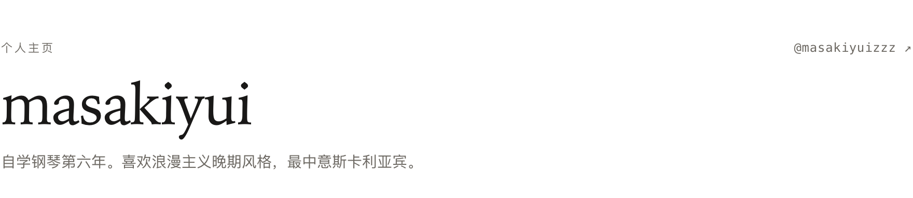
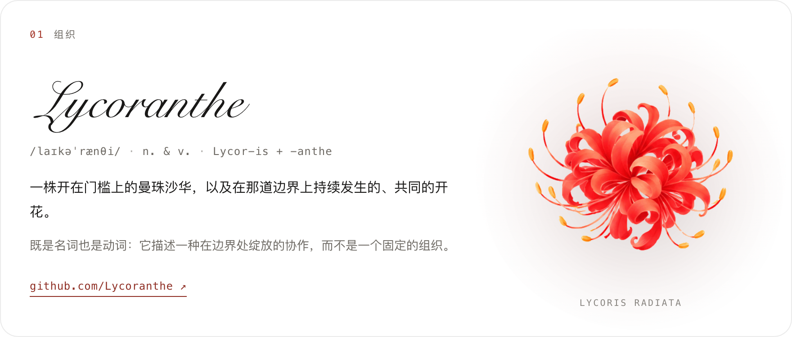
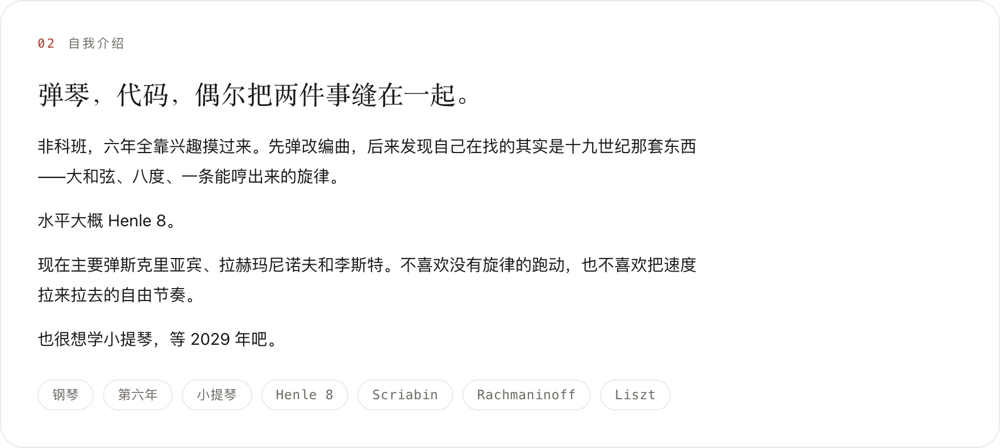
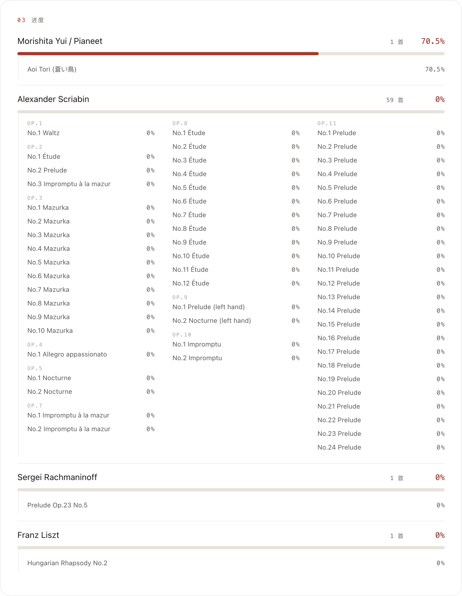

<picture><source media="(prefers-color-scheme: dark)" srcset="https://raw.githubusercontent.com/masakiyuizzz/masakiyuizzz/main/profile/card-dock-dark.png" /></picture>

<a href="https://github.com/masakiyuizzz"><picture><source media="(prefers-color-scheme: dark)" srcset="https://raw.githubusercontent.com/masakiyuizzz/masakiyuizzz/main/profile/card-hero-dark.png" /></picture></a>

<a href="https://github.com/masakiyuizzz/Lycoranthe"><picture><source media="(prefers-color-scheme: dark)" srcset="https://raw.githubusercontent.com/masakiyuizzz/masakiyuizzz/main/profile/card-org-dark.png" /></picture></a>

<picture><source media="(prefers-color-scheme: dark)" srcset="https://raw.githubusercontent.com/masakiyuizzz/masakiyuizzz/main/profile/card-about-dark.png" /></picture>

<picture><source media="(prefers-color-scheme: dark)" srcset="https://raw.githubusercontent.com/masakiyuizzz/masakiyuizzz/main/profile/card-prog-dark.png" /></picture>

Piano · <a href="https://github.com/masakiyuizzz/Lycoranthe">Lycoranthe</a> · <a href="https://github.com/masakiyuizzz">@masakiyuizzz</a> · 2026

