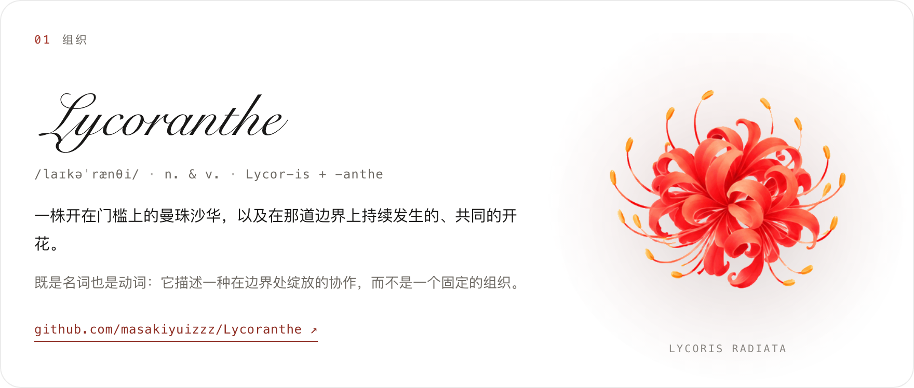

<picture><source media="(prefers-color-scheme: dark)" srcset="https://raw.githubusercontent.com/masakiyuizzz/masakiyuizzz/main/profile/ts-dark.png?v=1795617758" /></picture>&nbsp;&nbsp;<a href="https://github.com/masakiyuizzz/masakiyuizzz/blob/main/README.en.md"><picture><source media="(prefers-color-scheme: dark)" srcset="https://raw.githubusercontent.com/masakiyuizzz/masakiyuizzz/main/profile/lang-zh-dark.png?v=1795617758" /></picture></a>

<a href="https://github.com/masakiyuizzz"><picture><source media="(prefers-color-scheme: dark)" srcset="https://raw.githubusercontent.com/masakiyuizzz/masakiyuizzz/main/profile/hero-zh-dark.png?v=1795617758" /></picture></a>

<a href="https://github.com/masakiyuizzz/Lycoranthe"><picture><source media="(prefers-color-scheme: dark)" srcset="https://raw.githubusercontent.com/masakiyuizzz/masakiyuizzz/main/profile/org-zh-dark.png?v=1795617758" /></picture></a>

<picture><source media="(prefers-color-scheme: dark)" srcset="https://raw.githubusercontent.com/masakiyuizzz/masakiyuizzz/main/profile/about-zh-dark.png?v=1795617758" /></picture>

<picture><source media="(prefers-color-scheme: dark)" srcset="https://raw.githubusercontent.com/masakiyuizzz/masakiyuizzz/main/profile/prog-zh-dark.png?v=1795617758" /></picture>

Piano · <a href="https://github.com/masakiyuizzz/Lycoranthe">Lycoranthe</a> · <a href="https://github.com/masakiyuizzz">@masakiyuizzz</a> · 2026

